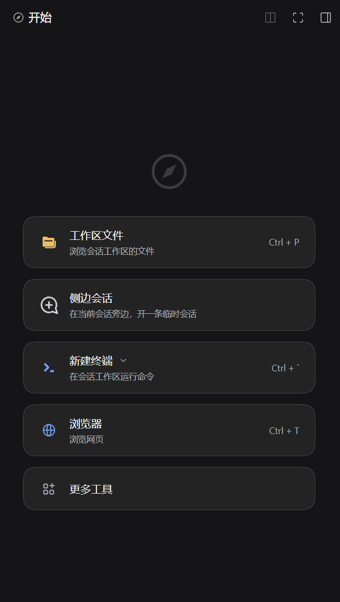
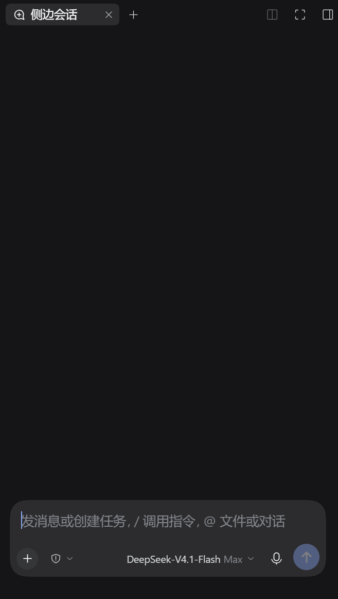

<h1 align="center">dsh-side: a temporary side session</h1>

<p align="center">
  English | <a href="README.md">中文</a>
</p>

<p align="center">
  <a href="https://github.com/Hourglass5177/dsh-side/stargazers"></a>
  <a href="LICENSE"></a>
  
</p>

---

## Overview

dsh-side gives DeepSeek Harness a lightweight, native temporary side conversation. It inherits the current conversation while its transcript starts empty; closing the tab stops the session and deletes that temporary session's record.

The session surface reuses DSH's native components: message rows, composer, `+` menu, permission, model selection, slash commands, `@` references, keyboard shortcuts and more — lightweight and easy to use.

## Screens

<p align="center">
  
  &nbsp;&nbsp;
  
</p>

<p align="center">
  
</p>

## Context inheritance

`/side` creates the side session with a **real session fork**: the parent's events are copied verbatim, so roles, tool calls, reasoning and permission events are all there and the model reads exactly the same conversation — no text compression, no truncation.

The panel shows only what came after the fork. The transcript is a Conversation view target registered by this plugin; it drops every event up to `session/end-seed`, so the **context is lossless and the panel stays clean**.

It joins the parent conversation workspace, so the composer workspace chip and the Workspace files page keep working.

The record appears as a collapsed entry at the top of the panel; expanding it shows what was inherited.

The permission preset follows the main conversation's current choice, so the side session does not ask again for what was already allowed.

## Install

Requires DeepSeek Harness **0.2.2+** (Desktop or Web).

```bash
git clone https://github.com/Hourglass5177/dsh-side.git
```

Install the local directory from the app:

1. Open **Plugins**;
2. Click **Add plugin** and select the cloned `dsh-side` directory;
3. `dsh-side` appears in the list once installed;
4. Restart the app once (the host half reloads), then refresh the page.

The field also accepts the Git address (`https://github.com/Hourglass5177/dsh-side`); once the plugin is published to npm, `dsh-side` alone is enough.

Web / CLI builds can install from the command line:

```bash
dsh plugin --profile <profile> add <absolute path to dsh-side>
```

The Desktop `desktop` profile is owned by the app; use the plugin page there.

Uninstall: disable the `dsh-side` row in **Plugins**.

## Usage

Two entry points with the same result:

- run **`/side`** in the composer;
- click the **Side session** card on the right sidebar's start page (the page with Workspace files / Terminal / Browser).

Ask in the composer at the bottom; answers stream as usual. Continue asking in the same panel to keep the side session going.

The side session joins the workspace of the conversation it was started from, titled 「Side session」, then 「Side session（2）」, 「Side session（3）」 for the ones still open. Numbers follow the sessions that exist, so deleting one frees its number for the next panel.

**Closing the tab ends it**: the side session stops and its stored transcript is deleted (the whole session directory is removed).

## Implementation

| | |
|---|---|
| **No dependencies, no build** | No npm dependencies, no bundler, no compile step; DSH loads `client.js` and `index.js` directly. |
| **Product UI reuse** | The panel renders `conversation.content`; the composer is `conversation.composer.bar`. |
| **Unchanged session model** | No new event types, no changes to the main conversation, no subagent catalog entries; a side session is an ordinary session. |
| **Parent carried in the id** | The child id embeds the parent id, so the host locates the source conversation by parsing the id; no title, index or polling is involved. |
| **Size** | ~566 lines browser-side, ~326 lines host-side, commented JavaScript. |

## Known limits

- **The transcript is drawn by this plugin**: the shell and composer are the product's own, but message rows, tool rows and reasoning blocks come from the plugin, so typography is close to — not pixel-identical with — the main panel. That is the price of lossless context plus a clean panel plus the official composer.
- **Streaming is wired**: text and reasoning appear while the attempt runs and are replaced by the committed message.
- **A Markdown subset**: fenced code, inline code, lists, headings, bold/italic and link labels; tables, footnotes and math are not rendered.
- **Deletion is best-effort**: if the app exits between archiving and the cleanup sweep, the session is deleted after the next start.
- Side sessions are listed as 「Side session」, then 「（2）」, 「（3）」 for the ones still open; numbers follow the sessions that exist.

## Development

```bash
npm test
```

Two dependency-free scripts: `test/client.test.mjs` drives the browser half with a simulated module loader and Cordis context, and `test/host.test.mjs` drives the host half with a simulated host context against a real temporary directory.

Conventions are in [CONTRIBUTING.md](CONTRIBUTING.md); releases are in [CHANGELOG.md](CHANGELOG.md).

## License

[MIT](LICENSE)
