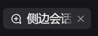
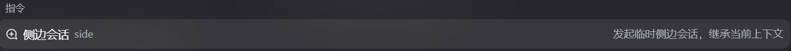

# dsh-side

**A temporary side session for DeepSeek Harness — the product's own conversation view, the current thread inherited as one context record, and the session deleted the moment you close it.**

No hand-written chat UI. No dependencies. No build step. ~900 lines of plain JavaScript.

English | [中文](README.md)



---

## What it is

In DeepSeek Harness (DSH), `/side` opens a **temporary session** in the right sidebar:

- it **inherits the current conversation** — the model can read the thread;
- but the transcript is **empty** — the inherited material arrives as one collapsed context record instead of a copy of the thread;
- the surface is **the product's own** — message rows, the composer (`+`, permission, model, voice, attachments, slash commands, `@` references), the circular send button, every keyboard rule. Nothing is reimplemented;
- closing the tab **stops it and deletes it from disk**.

Built for "quick aside" questions: without polluting the main context, without adding a row to the session list, and without leaving residue behind.



## Why it is light — and native

| | |
|---|---|
| **Zero dependencies, zero build** | No `node_modules`, no bundler, no compile step. DSH loads `client.js` and `index.js` directly. |
| **No reimplemented UI** | The panel renders the product's own `conversation.content`; the composer is the product's own `conversation.composer.bar`. Product updates and other plugins' composer contributions are picked up automatically. |
| **Non-invasive** | No new event types, no changes to the main thread, no subagent catalog entries. A side session is an ordinary session. |
| **Size** | ~590 lines client-side, ~320 lines Host-side, commented plain JavaScript. |

## Install

Requires DeepSeek Harness Desktop (or Web) **0.2.2+**.

```bash
git clone https://github.com/Hourglass5177/dsh-side.git
```

Then install the local directory from the app:

1. Open **Plugins**;
2. Use **Add plugin** and pick the cloned `dsh-side` directory;
3. `@local/dsh-side` appears in the plugin list when installation succeeds;
4. **Restart the app once** (the Host half reloads), then refresh the page.

> Web / CLI builds can use `dsh plugin --profile <profile> add <absolute path to dsh-side>`; the Desktop `desktop` profile is owned by the app, so use the Plugins page there.

Uninstall: disable the row in **Plugins**, or `remove_bundle`.

## Usage

**Entry 1 — slash command**

Type `/side` in any conversation's composer and submit.

**Entry 2 — the right Sidebar's start page**

The sidebar's start page (the compass page with Workspace files / Terminal / Browser) gains a **Side session** card. Clicking it starts a side session beside the conversation that panel is showing.

After it opens:

- the area above is an empty conversation (only one collapsible context record, expand it to read what was inherited);
- the composer at the bottom is identical to the main one;
- just ask your question there; keep asking in the same side session.

**Closing the tab ends it**: the side agent stops, the session is archived out of every list, and its stored transcript is deleted (the whole session directory is removed).

## How it works

```
/side
 ├─ Client  sessions.create()            a blank session (no fork seed copied into its log)
 │          rename(id, '〔side〕<parentSessionId>')
 │          open the product's conversation view in the right Sidebar
 ├─ Host    a new agent appears → read the title → parent id
 │          take the parent's model-visible messages → agent.inject(...)
 │          → one durable context record (the collapsed row in the panel)
 └─ close   archive + stop + delete that session's storage directory
```

The key constraint: the product's chat renders the session log, and a fork copies the parent's log into the child's — so "fork + official panel" can never start clean. `agent.inject()` is the one mechanism that makes content model-visible without becoming conversation rows, which is how this plugin gets all three at once.

## Known limits

- **Injection is asynchronous**: the Client creates and titles the session, then the Host polls for the title and injects (up to ~4 s). A message sent instantly may miss the inherited context on its first answer; the injection lands on the next step.
- **The parent must be live**: inherited text comes from the parent agent's model-visible messages. If the parent is unloaded the panel still opens, without inherited context (the Host logs it).
- **One context row is unavoidable**: model-visible content must be logged, and the product renders logged context.
- **Deletion is best-effort**: if the app exits between archiving and the next sweep, the archived session is deleted on the next start.
- Inherited context is plain text (speaker labels plus message text), without structured tool payloads.

## Layout

```
dsh-side/
├── client.js            # browser half: session creation, tab, title, entries
├── index.js             # host half: context injection + post-close cleanup
├── cordis.patch.yml     # plugin row declaration
├── package.json         # dsh.bundle / dsh.client manifest
├── locale/{en,zh}.json  # plugin page title and description
├── icon.svg             # plugin icon (same mark as the tab)
└── docs/                # screenshots
```

## License

MIT.
