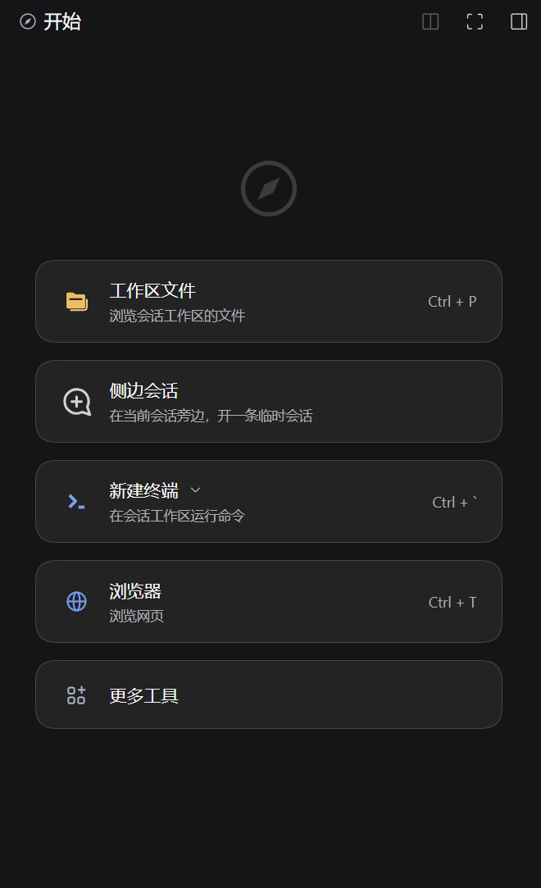

<h1 align="center">dsh-side: a temporary side session</h1>

<p align="center">
  English | <a href="README.md">中文</a>
</p>

<p align="center">
  <a href="https://github.com/Hourglass5177/dsh-side/stargazers"></a>
  <a href="LICENSE"></a>
  
</p>

---

## Overview

dsh-side gives DeepSeek Harness a lightweight, native temporary side conversation. It inherits the current conversation while its transcript starts empty; closing the tab stops the session and deletes that temporary session's record.

The session surface reuses DSH's native components: message rows, composer, `+` menu, permission, model selection, slash commands, `@` references, keyboard shortcuts and more — lightweight and easy to use.

## Screens

The panel as opened: empty above, the built-in composer below.

<p align="center">
  
</p>

The two entry points:

<p align="center">
  
  &nbsp;&nbsp;
  
</p>

## Context inheritance

dsh-side forks the current conversation at event zero: the child inherits the workspace, directory and agent preset but copies no messages, so the transcript starts empty. Event zero of a session log is a configuration event (a permission preset or a subagent descriptor), so it renders no chat row.

The context itself is injected: the host reads the parent's model-visible messages and writes them into the child as one context record. The transcript stays empty while the model can read the full context.

The record appears as a collapsed entry at the top of the panel; expanding it shows what was inherited.

## Install

Requires DeepSeek Harness **0.2.2+** (Desktop or Web).

```bash
git clone https://github.com/Hourglass5177/dsh-side.git
```

Install the local directory from the app:

1. Open **Plugins**;
2. Click **Add plugin** and select the cloned `dsh-side` directory;
3. `dsh-side` appears in the list once installed;
4. Restart the app once (the host half reloads), then refresh the page.

The field also accepts the Git address (`https://github.com/Hourglass5177/dsh-side`); once the plugin is published to npm, `dsh-side` alone is enough.

Web / CLI builds can install from the command line:

```bash
dsh plugin --profile <profile> add <absolute path to dsh-side>
```

The Desktop `desktop` profile is owned by the app; use the plugin page there.

Uninstall: disable the `dsh-side` row in **Plugins**.

## Usage

Two entry points with the same result:

- run **`/side`** in the composer;
- click the **Side session** card on the right sidebar's start page (the page with Workspace files / Terminal / Browser).

Ask in the composer at the bottom; answers stream as usual. Continue asking in the same panel to keep the side session going.

**Closing the tab ends it**: the side session stops, leaves every list, and its stored transcript is deleted (the whole session directory is removed).

## Implementation

| | |
|---|---|
| **No dependencies, no build** | No npm dependencies, no bundler, no compile step; DSH loads `client.js` and `index.js` directly. |
| **Product UI reuse** | The panel renders `conversation.content`; the composer is `conversation.composer.bar`. |
| **Unchanged session model** | No new event types, no changes to the main conversation, no subagent catalog entries; a side session is an ordinary session. |
| **Inheritance by the runtime** | The side session is a fork of the current conversation at event zero; workspace, directory and preset come from the runtime, and the plugin resolves no workspace. |
| **Size** | ~566 lines browser-side, ~326 lines host-side, commented JavaScript. |

## Known limits

- **Injection is asynchronous**: the browser creates the session and writes its title, then the host reads the title and injects (up to about 4 seconds). A message sent immediately after opening may answer without the inherited context; the injection applies to the next step.
- **The parent conversation must be online**: inherited text comes from the parent agent's model-visible messages. If the parent is unloaded, the panel still opens without inherited context and the host logs it.
- **The context record stays at the top of the panel**: model-visible content has to be written to the session log, and the product renders that log.
- **Deletion is best-effort**: if the app exits between archiving and the cleanup sweep, the session is deleted after the next start.
- Inherited content is plain text (speaker labels and message text), without structured tool payloads.

## Development

```bash
npm test
```

Two dependency-free scripts: `test/client.test.mjs` drives the browser half with a simulated module loader and Cordis context, and `test/host.test.mjs` drives the host half with a simulated host context against a real temporary directory.

Conventions are in [CONTRIBUTING.md](CONTRIBUTING.md); releases are in [CHANGELOG.md](CHANGELOG.md).

## License

[MIT](LICENSE)
