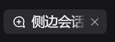
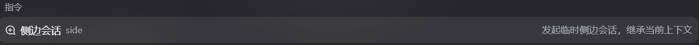

# dsh-side

**A temporary side session for DeepSeek Harness — the product's own conversation view, the current thread inherited as one context record, and the session deleted the moment you close it.**

复用产品自带会话面板，零自绘 UI，约 900 行原生 JavaScript。

[English](README.en.md) | 中文



---

## 是什么

在 DeepSeek Harness（DSH）里，`/side` 会在右侧边栏开一条**临时会话**：

- 它**继承当前对话**——模型能读到主对话的内容；
- 但对话区是**空的**——继承材料作为一条可折叠的上下文记录存在，不会把主对话抄一遍；
- 界面**完全是产品自带**的——消息行、输入区（`+`、权限、模型、语音、附件、斜杠命令、`@` 引用）、圆形发送键、全部快捷键，一行都没有重写；
- 关掉标签页**立即停止并从磁盘删除**该会话。

适合"问一句就走"的旁支问题：不想污染主对话的上下文、不想让它出现在会话列表里、也不想留下垃圾。



## 为什么是"轻量 + 原生"

| | |
|---|---|
| **零依赖、零构建** | 没有 `node_modules`、没有打包器、没有编译步骤。`client.js` + `index.js` 两个文件直接由 DSH 加载。 |
| **不重写任何 UI** | 面板渲染的是产品自己的 `conversation.content`；输入区是产品自己的 `conversation.composer.bar`。产品升级、别的插件改造对话框，这里**自动跟随**。 |
| **不侵入会话模型** | 不新增事件类型、不改主对话、不写子代理目录。会话就是一个普通会话。 |
| **代码量** | 客户端 ~590 行、Host ~320 行，全部是带注释的注释级原生 JS。 |

## 安装

需要 DeepSeek Harness Desktop（或 Web 版）**0.2.2 及以上**。

```bash
git clone https://github.com/Hourglass5177/dsh-side.git
```

然后在应用里安装本地目录：

1. 打开 **Plugins** 页面；
2. 用 **Add plugin**（添加插件）选择刚克隆的 `dsh-side` 目录；
3. 看到 `@local/dsh-side` 出现在插件列表中即安装成功；
4. **重启一次应用**（Host 半边需要重新加载），之后刷新页面即可使用。

> Web / CLI 版可用 `dsh plugin --profile <profile> add <dsh-side 的绝对路径>` 安装；Desktop 的 `desktop` profile 由应用独占管理，请用上面的 Plugins 页面安装。

卸载：在 Plugins 页面停用该行，或 `plugin_manager` 的 `remove_bundle`。

## 使用

**入口一：斜杠命令**

在任意对话的输入框里输入 `/side` 并回车。

**入口二：右侧栏「开始」页**

右侧边栏的起始页（指南针页，含工作区文件 / 终端 / 浏览器）会多出一张 **侧边会话** 卡片，点它即在当前会话旁开一条。

打开后：

- 上方是空白的会话区（只有一条可折叠的上下文记录，展开可看到继承的内容）；
- 底部是与主对话完全一致的输入框；
- 直接在底部提问即可；想继续追问就在同一条侧边会话里继续。

**关闭标签页 = 结束**：立即停止侧边会话、归档出所有列表，并删除它自己的会话记录（磁盘上的 `<会话目录>` 整个删除）。

## 工作原理

```
/side
 ├─ 客户端  sessions.create()            新建一个空白会话（不是 fork，日志里没有抄来的历史）
 │          rename(id, '〔side〕<父会话id>')
 │          右侧栏打开产品自带的会话视图
 ├─ Host    看到新会话 → 从标题取父会话 id
 │          取父会话的模型可见消息 → agent.inject(...)
 │          → 一条持久化的上下文记录（面板上就是那条折叠行）
 └─ 关闭    归档 + 停止 + 删除该会话的存储目录
```

关键点：**官方聊天面板渲染的就是会话日志**，而 fork 的 seed 会把父日志复制进子日志，所以「用 fork + 官方面板」必然显示整段历史。`agent.inject()` 是唯一能让内容对模型可见、却不变成对话行的机制——这就是本插件能同时做到「官方面板 + 真继承 + 空白面板」的原因。

## 已知边界

- **注入是异步的**：客户端建会话并写标题，Host 轮询到标题后注入（最多约 4 秒）。面板一开就立刻发消息时，首条回答可能还没拿到继承内容；注入会落在下一步。
- **父会话需在线**：继承内容来自父代理的模型可见消息；父会话已卸载时，面板仍会打开，只是没有继承内容（Host 会打日志）。
- **一条 context 行不可避免**：模型可见的内容必须落日志，产品会渲染日志——那条折叠行是最小可见痕迹。
- **删除是尽力而为**：应用在"归档后、下一轮清理前"退出时，该会话会在下次启动后的第一轮清理里删除。
- 继承内容是纯文本（说话人标签 + 消息正文），不含工具调用的结构化载荷。

## 目录结构

```
dsh-side/
├── client.js            # 浏览器半边：创建会话、标签页、标题、入口
├── index.js             # Host 半边：继承注入 + 关闭后回收
├── cordis.patch.yml     # 插件行声明
├── package.json         # dsh.bundle / dsh.client 清单
├── locale/{en,zh}.json  # 插件页标题与说明
├── icon.svg             # 插件图标（与标签页同一个标识）
└── docs/                # 截图
```

## 许可证

MIT。
